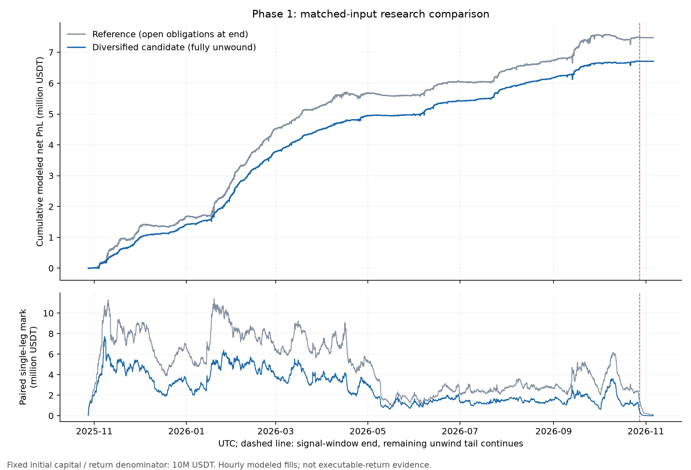
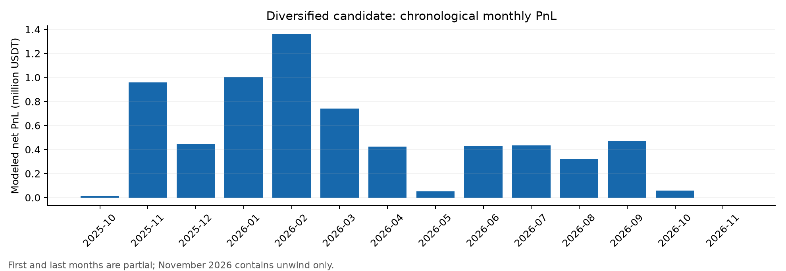

# 负资金费率策略：第一部分研究报告

研究完成日期：2026-11-07。币价、资金费和行情为历史数据；成交、自身费率影响及资金到账为模型。这里只交付策略研究，不搭建实盘执行引擎。

## 结论

原 v1 值得保留为基础，独立复跑没有支持“规则一修正就必然只剩约20%年化”的结论。更明确的优化空间在仓位容量、单币集中、保证金资金路径和退出兑现。优先研究候选保留严格−0.1%/8h、0.3%贴水、收入覆盖成本与24h原始结算合计转正锁退，新增更紧的流动性与集中度约束。

该候选完整模拟净收益 **670.94 万 U**，期间收益 **67.09%**；把一年主窗口及9天退出尾段一并计入时间，简单年化 **65.48%**。小时级最大回撤 **16.57 万 U**，为初始本金的 **1.66%**，不是盘中最大回撤或尾部风险上限。期末未平永续、未买回原币均为零。

这是一个可复核的研究版本，不能把65.48%当作实盘预期。自身费率影响、完整双腿成交路径及历史信息接收时点仍未标定或未取得。

## 1. 先验证v1，不把实现差异误当策略退化

冻结源提交为 `6cd6c23d6af5e0b92a3840fe44e09655d8adaed0`。旧独立数据包上，原门槛−0.05%为73.24%；只把首笔和加仓门槛换成严格−0.1%后为75.16414173387383%。扩展引擎关闭新功能后，净损益、资金费、手续费和价差损益与原版相等，见 `bridge_final/results.json`。

75.16%含21个估算尾仓，约137.92万 U；因此它证明可重复运行，不证明全部现金和原币已兑现。原仓库52.76%仍缺匹配原输入，不能宣称复现。新研究的数据覆盖、信息处理及退出时长变化另列，不能把下面所有收益差分摊成某一条修正的贡献。

同一旧输入依次修正波动率回填、零费率结算事件、下单预算时点和当小时原始成交量约束，主窗口标记结果约74.58%；再计入该旧数据实际可见120h尾段为73.76%，仍有尾仓。改成339币新输入、216h尾段及公告处理后，参考为72.95%，仍有8.06万 U尾仓。

## 2. 数据取得与可用范围

| 项目 | 本次状态 |
|---|---|
| 数据跨度 | 2025-07-01至2026-11-06 UTC，末时点不含 |
| 配对品种 | 339；研究年度内有行情336；比旧315增加21个年度内品种 |
| 真实已结算费率记录 | 817,306，含861条零费率结算 |
| 校准聚合 | 原4296个币日 + 新317个币日，共4613；固定日历选样 |
| 原始压缩档案完整性 | 审计快照核对官方校验和52,862份；缺文件0，哈希错误0 |
| 分钟抽查 | 56个币日，705个小时净仓位变化，缺档0 |
| 当前数量规格 | 338个配对可取得；不是历史步长证明 |
| 公告事件 | 四份官方公告，覆盖8个新增品种 |

数据源及2025年现货微秒时间戳规则见 [Binance Public Data](https://github.com/binance/binance-public-data/)。旧315币主区间行情保留原输入，补下载预热、尾段、新品种、结算费率、OI与mark行情；并非声称从零重建所有老数据。11月结算由公开API补齐，档案无数据和HTTP404明确保留，未伪造缺失行情。

历史公告收到时间、历史真实订单步长、完整保证金档位及持续L2不齐全。新加入品种按用户提供的映射配对，价格比合理不等于原币身份已经核验。库存按用户静态可用假设计，仍存在条件选择偏差。

## 3. 同数据比较

统一主窗口2025-10-28至2026-10-28，加216h只退出尾段，共8976h。每个结果都按 `净损益/1000万×8760/8976` 年化。单位“万”为USDT；尾仓不为零时，完成退出年化字段为空。

| 版本/压力 | 模型简单年化 | 期间净收益/万 | 小时最大回撤/万 | 未退出名义额/万 | 全部模拟退出 |
|---|---:|---:|---:|---:|---|
| 同数据风险修正参考 | 72.95% | 747.45 | 32.07 | 8.06 | 否 |
| 成交额2% + OI5% | 65.98% | 676.10 | 20.39 | 0.00 | 是 |
| 成交额5% + OI2.5% | 65.09% | 666.97 | 15.68 | 0.00 | 是 |
| 优先候选：再加单币限制 | 65.48% | 670.94 | 16.57 | 0.00 | 是 |
| 候选：价差与冲击翻倍 | 63.29% | 648.54 | 16.68 | 0.00 | 是 |
| 候选：自身费率影响k=6 | 55.72% | 570.95 | 16.71 | 0.00 | 是 |
| 候选：双倍成本且k=6 | 53.57% | 548.89 | 16.84 | 0.00 | 是 |

单看收益最高的“成交额5%+边际影响仓位”约81.90%，仍有1.71万 U未退出，不能自动胜出。优先候选的平均投入成本约292.68万 U，峰值728.29万 U；分母始终是1000万，不能拿平均占用金额替换后放大年化。

## 4. 独立测试了哪些原有规则

以下每项只在同一参考基础上改列出的规则，均采用当前数据和公告处理；不是优先候选的压力表。

| 单项改动 | 模型年化 | 尾仓/万U |
|---|---:|---:|
| 门槛−0.05% | 71.07% | 10.82 |
| 门槛−0.2% | 75.44% | 6.79 |
| 最新结算非负就退出 | 69.15% | 6.93 |
| 24h合计转正需连续6h | 71.59% | 8.06 |
| 收入成本倍数由2降为1 | 57.80% | 9.39 |
| 按预计净收入/成本排序 | 72.53% | 8.06 |
| 训练退出口径与实际对齐 | 73.37% | 7.23 |

参考为72.95%。放宽收入覆盖要求并没有因“资金用得更多”而改善结果，反而降低收益、放大回撤。看到最新一次非负就退出也未改善本样本，因此暂保留原24h原始结算合计退出。提高门槛至−0.2%虽提高本年结果，尚无新样本证明稳健，不据此替换既定−0.1%。

首笔T−1h独立实验为73.35%，比参考仅高约0.40个百分点且仍有尾仓；同样流动性2%上限下，无等待为65.79%，等待降至61.92%。共同8760h的周块重采样不能确认强制等待有稳定收益优势。该日程根据最近一次已知间隔延续，并非历史真实收到的结算公告；因此主候选不强制等待，后续实时有准确日程再做对照。加仓没有被限制在T−1h。

## 5. 集中度：为何还要再加一层限制

仅收紧成交额和OI的两个候选，都曾在ZEC达到约564.68万 U单币市值。新增单币100万 U投入成本上限和上一小时市值目标后，优先候选单币峰值降为132.99万 U（LSK）。104个币小时仍超过100万目标，最大超额32.99万 U；跳价、上一小时观察及正常参与率减仓均可能导致超额，模型没有强行瞬时抹平。

此改动不是按本年最高收益选阈值。10%为风险约束判断，20%只做敏感性对照；二者没有新样本外胜负证明。单币限制使尾部暴露更可控，并没有在所有指标上占优：优先候选小时回撤16.57万，略高于无单币限制的低OI版本15.68万。

当前优先候选按“名义额×持仓小时”分布，1h约18.73%、4h约67.87%、8h约13.40%。包含1h合约；这些比例不是各周期利润贡献。

## 6. 损益和两账户核算

优先候选模型资金费净收入824.82万 U，双腿价差损益（已含价差与冲击）-123.12万 U，手续费30.76万 U，合计670.94万 U。不能再把另列的冲击诊断重复扣一次。自身费率影响在持仓路径上的收入削减约206.65万 U，是模型反事实差，不是交易所手续费。

旧钱包模型只在B余额变负后补钱，忽略“余额为正、1x开仓保证金已经不足”。修正后，在同样联合损益上从A已存在现金调拨，不引入外部资本。大仓位参考累计A→B约684.51万 U；固定成交路径延迟4h到账时，B最大1x保证金缺口约72.24万 U。仅检查钱包非负会漏掉这个问题。

优先候选本次历史路径没有需要跨账户调拨的时点；小时标记价格代理下1x初始保证金不足0小时，联合账本最大误差约1.5e-07U。该结果不能推成未来永远不用转账。压力场景也保留账户审计，未来应以实际可用/可划转保证金为准，而非把未实现浮盈提前花掉。

## 7. 成交证据及未覆盖风险

56个币日按每月最多4个、币名日期SHA256排序抽取，不按盈亏挑选。在3%双边较小分钟成交量约束下，延后1分钟的金额加权当小时匹配比例97.30%，延后5分钟为92.09%。对应完整匹配小时为361/705和311/705。统计对象是小时净仓位变化，低于可能发生的真实总成交量；没有盘口、排队、两腿不同时成交的证明。

分钟样本与整小时VWAP的价差对比不能年化外推。样本也没有覆盖全部大额ZEC集中减仓时点，不能凭97%/92%宣布整个组合可成交。手续费沿用VIP3假设；现货0.06%可核对[官方费率表](https://www.binance.com/en/fee/trading)，用户实际账户历史收费未取得。

最需要下一步标定的是自身仓位推动资金费率的幅度：k=4表示每占OI的1%，每8h费率抬升4bp。例如持仓达到OI的2.5%，模型抬升10bp，足以抵消门槛附近的负费率。k=6不是已验证真值，也不应该为了收益好看把k调低。

下架与换币可直接破坏对冲。此次加入[STG合并公告](https://www.binance.com/en/support/announcement/detail/0c1e8975f48d42c4b856c113926c5fdd)等四份通知，在公告可用后才禁入并退出；永续交割与现货停止日不同，不能假设币一直能买回。公告当前内容存在修订，历史快照缺失仍列为限制。

完整边界见 `strategy/docs/MODEL_LIMITS.md`，包括静态现货价差先验、成交额深度代理、无历史精确接收时间、连续数量、保证金阶梯、ADL和交易所停机。当前低回撤部分依赖双腿同步配对假设，不能视为真实尾部风险上限。

## 8. 时间稳定性与可接受的结论

| 独立起跑窗口 | 含退出尾段小时 | 净收益/万U | 简单年化 |
|---|---:|---:|---:|
| IS | 6120 | 541.06 | 77.45% |
| HO | 3072 | 128.65 | 36.68% |
| FY | 8976 | 670.94 | 65.48% |

IS为2025-10-28至2026-07-01，HO为2026-07-01至2026-10-28；分别从空仓运行并加退出尾段，不能将两者直接相加当FY。HO已被之前研究观察，不能改名为全新样本外测试。优先候选前段年化77.45%、后段36.68%，变化明显；全年65.48%不能掩盖后段衰减。

共同8760h下，优先候选相对参考差为约−7.76个百分点，探索性周块95%区间约[−17.48,2.06]个百分点；未进行多重试验校正，也不是风险调整收益显著性证明。

我建议把 `candidate_diversified.json` 冻结为后续影子验证的优先研究版。保留原v1信号和退出主逻辑；优先验证容量、集中、到账和原币回购，暂不按本年结果改成更高门槛、最新非负即退出或强制T−1h。真正需要用后续实际数据更新的是双腿成交不足、自身费率衰减、分币成本和退出时间，而不是只追求回测年化。

## 9. 交付及范围

交付策略参数、全部引擎实参、规则、输入哈希、逐场景结果、逐月损益、17项边界检查和证据包。原始数据与私有库存保留本地受控目录。执行侧JSON接口在下一阶段按冻结策略版本更新；旧接口包未自动同步本候选。没有实盘下单、转账或宣称生产已完成。
